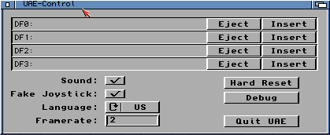
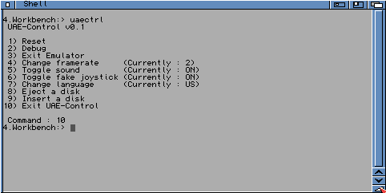

# Amiga Programs

Along with the WinUAE emulator program, some programs are
supplied in the 'Amiga Programs' folder of the WinUAE
installation. Here is an explanation of what these files
are for and where to copy them to:

## timehack

This tool synchronizes the Amiga time with the current
Windows time every second. You need this when you use the
hibernation feature of your PC and resume to get exact time. If
you need exact time (for compiler make) it is also recommended
to use this because UAE cycletiming differs by about 1-2
seconds per hour.

Copy it to the Amiga system directory c. Start it in your
Userstartup with the command run >nil: timehack.

Alternatively, the **Synchronize clock** option on the
[Misc](../gui/misc.md) page keeps the Amiga clock in sync
without an Amiga-side program.

## transdisk

Copy this program file to your C directory on your Workbench
disk or hard disk. This can Transfer Disk images to or from
floppy disk to an image or vice versa in ADF (Amiga Disk
Format). Type *transdisk ?* for more options. See
[Create Image Files](../howto/imagefiles.md) page
for more details on this program.

## transrom

Copy this program file to your C directory on your Workbench
disk or hard disk. This can Transfer the Kickstart ROM image
from a real Amiga to an image file to use with your Amiga
Emulator. It will produce either a 256K or 512kB sized file.
See [Create Image Files](../howto/imagefiles.md)
page for more details on this program.

## ahidriver.zip

This archive contains the AHI driver for UAE: UAE.audio is the
driver itself, UAE the matching audio mode file. Copy the files
to the AHI drawers in Devs: on your Workbench or hard disk. The
driver enables support for recording and playback with a
sampling rate up to 96 kHz in 16 bit and works fully
independent from Paula sound. For a speed boost on slower
systems, you can set the Paula buffer to 5 or 6, and choose
11kHz Mono, which is enough to hear system sounds.  
If you installed the driver correctly, it should offer you only
1 mode: UAE HiFi stereo++.

## UAE\_German

This is a German keymap file for access to @\~{[]} with
ALT-GR like Windows. Copy it to devs/keymaps and select in
Input prefs.

Note: This is an old one that works in input compatibility
mode. For 100% compatibility Mode (Euro Char) use
german\_KeyMap\_new.zip in this folder and choose anything other
in input tab than Compatibility Mode and remap # Key to
0x2b.

## uae\_rcli

Remote CLI. Usage: uae\_rcli [?|-h] [-debug] [-nofifo]
[&lt;delay>]

## uae-control

Copy this program file to your Utilities folder or some
other folder on your Workbench disk or hard disk. It will
provide a user interface within the emulator to control the
floppy drives, reset, quit and other features without having to
press F12 to bring up the WinUAE interface.

{ .center }

## uaectrl

Copy this program file to your C directory on your Workbench
disk or hard disk. This is the Shell equivalent of the
uae-control program where you can change floppies, sound,
joystick, reset or quit the emulator from a simple text
menu.

{ .center }

## uae-configuration

Copy this program file to your C directory on your Workbench
disk or hard disk. It reads and changes WinUAE configuration
entries from the Shell while the emulation is running.

## UAEquit

Quits WinUAE from the Amiga side.

## WinUAEclip

This program allows you to have access to Windows Clipboard
so you can copy/paste files from/to WinUAE.

Alternatively, for sharing plain clipboard contents, the
**Clipboard sharing** option on the [Misc](../gui/misc.md) page
needs no Amiga-side program.

## WinUAEnforcer

This program allows Enforcer support to detect bad memory
access when developing programs or debugging. For 100% safety,
use [JIT](../emulation/jit.md) in Indirect Mode.
Make sure you use a tool that moves your VBR to Fast RAM. MCP
or some other tools on Aminet do that. You can also use
Segtracker from a real Amiga to find the program and offset of
a hit.

## p96refresh

Start this program to get higher mouse pointer redraw rates
than 50Hz with P96. Results are seen immediately after call. You
can start this in your user-startup for automatic load during
booting the system.  
**Note:** If you use this, you must check if your
CPU IDLE slider is set in correct position. In the worst case,
the Amiga system clock will run slower. Set the IDLE slider so
that in Windows task manager the CPU load of a Workbench screen
shows about 10-15%.  
**Example:** p96refresh 75 sets the redraw rate to
75Hz. It is recommended to set the rate according to the actual
monitor refresh rate, or the doubled number. Do not set it
higher or you get a speed loss greater than 2%.

## sources.zip

The source code of the supplied Amiga programs.
