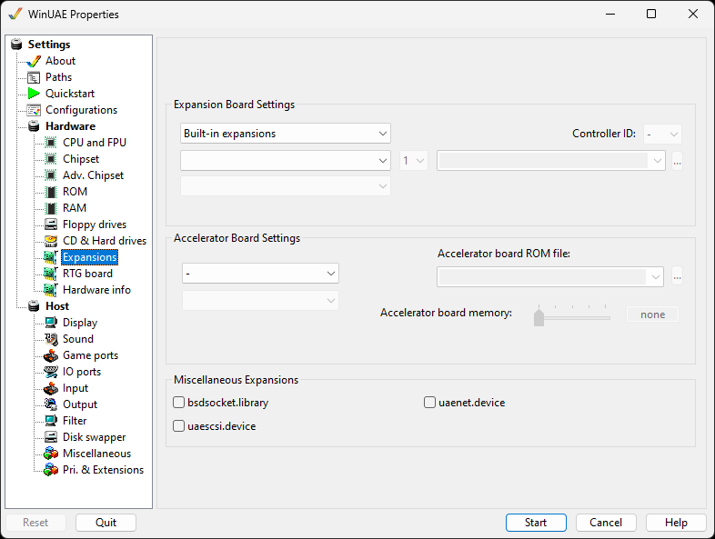

# Expansions

This will change settings for expansion cards such as RTG,
Network, and SCSI cards.

{ .center }

## Expansion Board Settings

**Controller or Bridgeboard selection** for
Built-in expansions, SCSI, IDE, SASI and Custom controllers,
PCI and x86 Bridgeboards, Graphics boards, Sound cards,
Network adapters or Disk controllers.  
**Controller model selection** for the make and
model of required controller or bridgeboard. Click
**Enabled** to enable/disable this controller
selection.  
**Controller series selection** for controllers in
the same series.  
**SCSI Controller ID:** Specify a SCSI controller
ID (0-7).  
**SCSI/IDE/Boot ROM file.** allows you to specify an
expansion card and ROM file and model. Up to 4 separate files
can be selected.  
**Autoboot disabled** The Amiga will not start from the
drives of this board on its own.  
**PCMCIA inserted** Whether the PCMCIA card is plugged
in.  
**24-bit DMA** Limits the controller to the memory a real
Zorro II card could reach.  
These three are only available for boards that support
them.

## Accelerator Board Settings

**Accelerator make selection.** Select ACT,
Commodore, DCE, DKB, GVP, Kupke, MacroSystem, M-Tec, Phase 5,
RCS Management, Interactive Video Systems, Progressive
Peripherals & Software, Computer System Associates, Hardital
or Harms.  
**Accelerator board selection.** Select the actual
accelerator board.  
**Accelerator board ROM file**. Select the
Blizzard PPC or Cyberstorm accelerator board ROMs.  
**Accelerator board memory** amount of memory for
the board (0-256 MB). This is kept in sync with the
matching memory size on the [RAM](ram.md) page.

## Miscellaneous Expansions

**bsdsocket.library** Allows the Amiga to use
the network connection of the host.  
**uaescsi.device** Adds support for IDE/SCSI
CD-ROM drives on the Amiga side.  
**uaenet.device** Enable SANA2 compatible network
devices. It works out of the box by sharing the internet
connection of the PC. To give the Amiga direct access to
your network adapter, install [Npcap](../links.md#essential).
