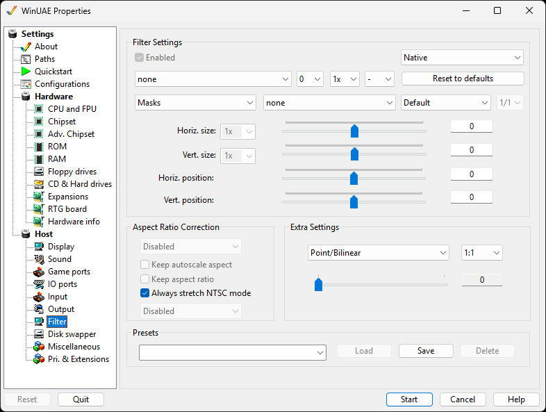

# Filter

In this section, the picture can be scaled, moved and run
through filters, for example to make it look like an old
CRT monitor.

{ .center }

## Filter Settings

Set to either **Native**, **Native
(Interlaced)** or **RTG** mode. Each has its own set of
filter settings.  
The filter list offers **None** and the Direct3D shader
filters found in the filtershaders folder of WinUAE. The
built-in filters of older versions (Scale2X, hq2x,
SuperEagle and so on) no longer exist.  
Scaling can be **Point** (sharp pixels) or
**Bilinear** (smooth).  
The scaling mode decides how the picture is fitted to the
window or screen, for example Automatic scaling, Integer
scaling or Fullscreen (TV).  
The **Horizontal and Vertical Sizes** and
**Positions** can be fine-tuned with the sliders.  
Masks and overlays can be selected if any are installed.

## Aspect Ratio Correction

You can specify the aspect ratio: Disabled, Automatic, or
a fixed one such as 4:3, 5:4, 16:9, 16:10 or 21:9.  
**Keep autoscale aspect** ensures that any filter
will ensure display keeps its autoscale ratio correct to avoid
distortions.  
**Keep aspect ratio** ensures that any filter will
ensure display keeps its aspect ratio correct to avoid
distortions.  
**Monitor type** can be Disabled, VGA or TV.  
**Always stretch NTSC mode** stretches NTSC screens to
the height of PAL screens.

## Extra Settings

**Point/Bilinear** can be specified, and ratios
from 1:1 to 3:3 and from slider from 0 to 1.  
**Scanline** can be specified as Scanline opacity,
level or offset and ratios from 1:1 to 3:3.  
**Scanline Brightness** can be specified from 0 to
100.

## Presets

Filter settings can be saved as a **Preset** if
you wish to reuse Filter settings in other configurations.  
Previously saved settings can be **Load**ed or
**Deleted,** if not required.
