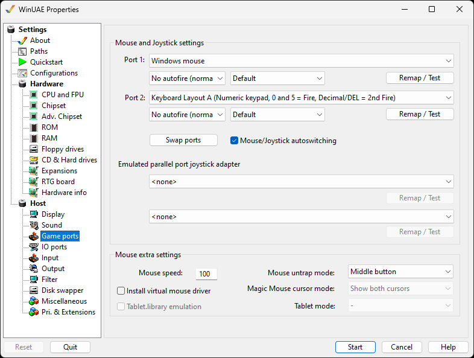

# Game Ports

These settings let you choose what is plugged into the
mouse and joystick ports of the Amiga.

{ .center }

## Mouse and Joystick settings

With these 2 options you can select the configuration of the
Amiga ports. **Port 1** is usually used by the Amiga mouse,
**Port 2** by a joystick. It is easy to exchange the settings
with the **Swap ports** button.  
**Windows mouse** is the normal mouse of your PC.
**X-Arcade** is for joysticks with built in key mappings.  
For either port you can select a Mouse, an X-Arcade device, a
pre-defined Keyboard layout or a joystick if it is installed
and connected to your PC.  
If you move your mouse over **X-Arcade layout
information**, you can view the buttons and so on and
what keys they are mapped to.  
For the **Parallel port joystick adapter** you can
select an X-Arcade device, Keyboard layout or other installed
joystick.  
Use the **Remap** button for an easy way to remap
directions and buttons for the device.  
Press **F12** to exit remap or test modes. Press
**F11** to skip an event in the window.  
**Mouse/Joystick autoswitching** Press a button on a mouse
or joystick that is not in use to plug it into a port
automatically.

## Mouse extra settings

Mouse speed controls the speed of the mouse pointer across
the screen. 100 is max speed, 50 is half speed etc.  
Mouse untrap mode selects how the mouse pointer gets out of
the WinUAE window: None (Alt-Tab), Middle button, Magic mouse
(just move it across the window border) or Both.  
A Virtual mouse driver can be installed for other features.  
Magic Mouse cursor mode can be Show both cursors, show native
cursor only or show host cursor only.  
Tablet mode and Tablet.library emulation let a drawing tablet
connected to your PC work as a tablet on the Amiga. No
Amiga-side program is needed.
