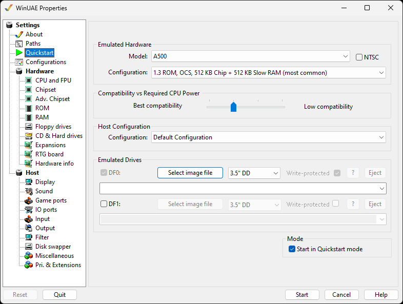

# Quickstart

Setting up WinUAE can be an extremely complex task,
especially for users who are not tech-savvy. That's where
Quickstart comes in: it will quickly get you going if all you
want is to emulate a certain model of Amiga.  
It is entirely optional.

{ .center }

## Emulated Hardware

**Model** - Select the model of Amiga you want
to emulate: A500, A500+, A600, A1000, A1200, A3000, A4000,
CD32, CDTV, American Laser Games / Picmatic, Arcadia,
Macrosystem or the Expanded WinUAE example configuration.  
**NTSC** - Emulate an NTSC (60Hz) machine instead of a PAL
(50Hz) one.  
**Configuration** - Select the common types of
Kickstart, chipset and memory configurations you require from
this list. This list changes depending on the model of Amiga
you selected.

## Compatibility vs required CPU power

**Best compatibility - Low compatibility -** Select whether
you want more Amiga chipset compatibility or faster CPU speeds
from this slider.

## Host Configuration

**Configuration** - Select which display, sound and input
settings to use: the current ones, the defaults, or one of
the saved host configurations (for example Windowed or
Fullscreen).

## Emulated Drives

These options are identical between **Floppy drive DF0:
/ Floppy drive DF1:**:  
**Select image file** - To load an ADF file to the
emulated drive.  
**3.5" DD / 3.5" HD** - Allows selecting the
emulated floppy drive density.  
**?** - Open the disk image information.  
**Write protect** - Write protect the disk
image.  
**Eject** - Eject the disk image.

For CD32 and CDTV, a CD drive or CD image is selected here
instead.

## Mode

**Start in Quickstart mode** - If enabled, then
the Quickstart mode is the default.  
**Set configuration** - Applies the selected Quickstart
configuration.
