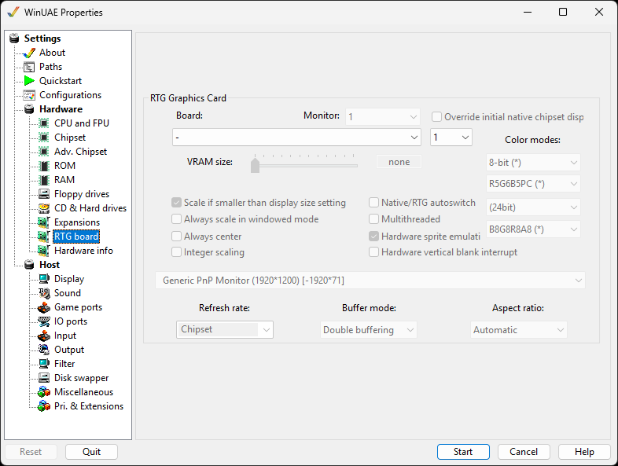

# RTG Board

{ .center }

## RTG Graphics Card

**Board** selects the emulated graphics card.
The UAE card (Zorro II or Zorro III) is the fastest and the
best choice for most users. Real cards are also available:
A2410, Picasso II, II+ and IV, Piccolo, Spectrum 28/24,
CyberVision 64 and 64/3D, Retina, Merlin, Harlequin, Voodoo
3, S3 Virge, Matrox boards and the x86 Bridgeboard VGA.  
**Monitor**. Multi-monitor selection (default:
1 of 1-4).  
**Override initial native chipset display** Shows the
graphics card output right from the start, instead of the
Amiga's own display.  
**VRAM size.** Video ram is for graphics card use
such as the Picasso96 RTG so that you can use your PC's
graphics card rather than the custom chips for extra speed.
Up to 1 GB  
**Scale if smaller than display size setting**
Rescale display if current window is smaller than the display
size setting given  
**Always scale in windowed mode** Rescale display
instead if using windowed mode.  
**Always center** Will make sure RTG display is
centered in middle of monitor.  
**Integer scaling** Use integer type scaling for
RTG.  
**Native/RTG autoswitch** Switches automatically between
the Amiga's own display and the graphics card, depending on
which one is in use. Enabled by default.  
**Multithreaded** Use RTG board's multithreading
for performance.  
**Hardware sprite emulation** If board supports
it, enable sprite emulation  
**Hardware vertical blank interrupt**
emulation  
**Color modes:** Specify color depth (in bits),
and other modes available for the card.  

**Monitor selection** selects the PC screen the graphics card
is shown on.  

**Refresh Rate** This can be Chipset, Default or 50,
60, 70 or 75 Hz.  
**Buffer Mode** This can be Double or Triple
Buffering for graphics.  
**Aspect Ratio** This can be Disabled, Automatic,
4:3, 5:4, 15:9, 16:10, 27:16, 128:75, 16:9, 256:135, 21:9, 32:9
or 16:3
